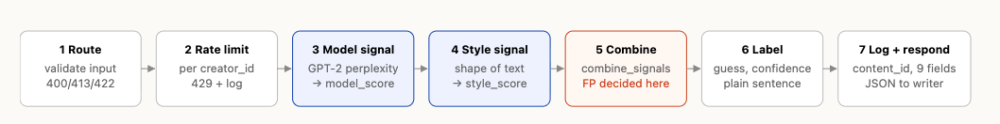

# Provenance Guard

> ### 👋 Start here
>
> **New to this repo? Read [RUNNING.md](RUNNING.md) first.**
>
> Once `python test.py` passes, in one terminal:
>
> ```bash
> python app.py
> ```
>
> and in another:
>
> ```bash
> curl -X POST http://127.0.0.1:5000/ping \
>   -H "Content-Type: application/json" \
>   -d '{"message": "hello"}'
> ```
>
> That's a web service. Something sent it text and it sent something back.
> Everything this unit is filling in the middle.
>
> **The rest of this file is your submission.** Fill it in as you go.

---

<!-- ─────────────────────────────────────────────────────────────────────────
     Unit 7 asks for the first five sections. Unit 8 adds the five below.

     Everything is pasted as TEXT. A pasted curl response gets full credit;
     a picture of your terminal gets none.
     ───────────────────────────────────────────────────────────────────────── -->

<!-- ═══════════════════════ UNIT 7 — THE BUILD ═══════════════════════ -->

## What This Does

<!-- The path a submission takes, from arriving to the label a reader sees.
     Six or seven steps — this is the trace you wrote in Milestone 1. -->



1. **Route (`app.py::submit`).** Parses the JSON and rejects bad input before any model runs. Missing, empty or non-string `text`, or a missing `creator_id`, gets a 400. More than 20,000 characters gets a 413. Under 40 characters, or text that isn't English prose, gets a 422. Every rejection is logged.
2. **Rate limiter (unit 8).** Counts requests per `creator_id`, falling back to IP. Past the limit: 429 plus a `rejected` log entry.
3. **Signal one (`detector.model_signal`).** GPT-2 reads the first 400 tokens. Low perplexity gives a high `model_score`.
4. **Signal two (`stylometry.style_signal`).** Sentence-length spread, expressive punctuation and a small weight for stock AI words give `style_score`.
5. **Combining rule (`scoring.combine_signals`).** An equal-weight average, except that disagreement between the signals can block an "AI" label.
6. **Label (`scoring.score_to_label`).** Produces the `guess`, a plain-language sentence, and `confidence = |combined − 0.5| × 2`.
7. **Log and respond (`audit.log_decision`).** Writes all nine fields plus `confidence` and `truncated`, and returns them with a `content_id` the writer can use to appeal.


---

## Signals and Scoring

<!-- For each signal: what property it measures, why that might differ between
     human and AI writing, and WHAT IT CAN'T SEE.

     The blind spot is not optional. If you can't name it you don't understand
     the signal yet — and unit 8's attack set is built out of blind spots. -->

### Signal one — the model signal

**What it measures:** How predictable the text is to GPT-2 (perplexity over the first 400 tokens), passed through a logistic curve so that perplexity 45 scores 0.5 and lower perplexity scores higher (more AI-like).

**Why that might differ between human and AI writing:** A language model writes by repeatedly choosing a likely next word, so its output is easy for a model to predict. People make odd word choices, change direction suddenly and add specific details no model would guess.

**What it can't see:** Who wrote the text. It only sees how ordinary the words are. Plain writing in common words scores as machine-like: my plain human running paragraph scored **0.871**, *higher* than the generic AI essay at **0.853**. It also can't see anything after token 400 (about 300 words), and rare words or typos pull AI text toward "human".

### Signal two — the style signal

**What it measures:** The shape of the text, without reading it:
- *Sentence-length spread* (standard deviation ÷ mean of words per sentence; 0.20 or below scores fully AI-like, 0.80 or above fully human-like), weighted 0.5.
- *Expressive punctuation* (`; : — – ( ) ! ?` and quotation marks per 100 words; 0 scores fully AI-like, 4 or more fully human-like), weighted 0.3.
- *Stock AI words* (1,075 words and phrases in [`ai_words.txt`](ai_words.txt), like "delve", "furthermore", "crucial", "in conclusion", "it is important to note", with every verb form listed; 0 per 100 words scores 0, 3 or more scores fully AI-like), weighted 0.2. It has the smallest weight on purpose: formal human writers use "furthermore" and "crucial" too, so the list can nudge the score but never decide it.

**Not measured: vocabulary variety.** I removed word choice (type-token ratio) on purpose. AI can settle into a set vocabulary, but so can people: second-language writers, plain writers, anyone with a house style. A measure that can't tell those apart would accuse exactly the writers this service most needs to protect. It also ran backwards on my calibration set: the AI essay scored 0.90 and the human one 0.86.

**Why that might differ between human and AI writing:** AI text is even, with mid-length sentence after mid-length sentence, commas and full stops. Human writing is lumpy: "Hours." next to a 40-word sentence, plus dashes and brackets.

**What it can't see:** Meaning. Anything that changes the shape without changing the content moves it: a few dashes, chopped sentences, a pasted quote. My lightly edited AI text scored only **0.306** after I added dashes and short sentences. It also shares signal one's blind spot: plain human writing has even sentences and no expressive punctuation, so it scored **0.652** even with zero stock AI words.

### The combining rule

<!-- Write the rule in words, then give the numbers. What happens when the two
     signals disagree? -->

**The rule:** Average the two signals equally, since neither earned more trust: each was fooled by a different input. Then apply one exception. If the signals are more than 0.30 apart, cap the score just below the AI line. Disagreement can block an accusation but can never cause one, so one signal alone can never label someone's writing AI. The cap only works one way, because a split ending in "human" or "unsure" costs the writer nothing.

**The numbers:** `WEIGHT_MODEL_SIGNAL = 0.5`, `WEIGHT_STYLE_SIGNAL = 0.5`, `DISAGREEMENT_GAP = 0.30`, `HUMAN_THRESHOLD = 0.35`, `AI_THRESHOLD = 0.88` (all in `config.py`).

Calibration (model / style / combined → label):

| Input | model | style | combined | label |
|---|---|---|---|---|
| Clearly AI (generic essay; 5.07 stock AI words per 100) | 0.853 | 0.968 | 0.910 | ai |
| Clearly human (grandmother's buttons) | 0.260 | 0.000 | 0.130 | human |
| Plain human (running) | 0.871 | 0.652 | 0.761 | unsure |
| Formal human (legal opinion style; 1.77 stock AI words per 100) | 0.714 | 0.765 | 0.739 | unsure |
| Human student essay ("Furthermore", "In conclusion"; 3.80 per 100) | 0.737 | 0.964 | 0.850 | unsure |
| Lightly edited AI | 0.556 | 0.246 | 0.401 | unsure |

I set `AI_THRESHOLD` at 0.88, not 0.65, because of the plain human row. Before the stock-AI-words measure it scored 0.847, and at 0.65 three of my five texts would have been labelled AI, two of them human. Adding the word list moved plain human writing down to 0.761 (it has none of those words) while the generic AI essay stayed at 0.910 (it is full of them), so the gap between them grew from 0.06 to 0.15. The cost: AI text only slightly less generic than my sample lands in "unsure". This rests on one sample of each, so criterion 1 tests it against real writing.

**Known risk from the word list:** students are *taught* "Furthermore" and "In conclusion". A human student essay full of them scored 0.850, only 0.03 under the AI line. The word list is the reason (it saturated its 0.2 share), so if criterion 1 fails on school-style writing, this is the first thing to turn down.

**Where it lives:** `scoring.py::combine_signals`

<!-- ⚠️ The grader checks your code against that line. If your rule lives
     somewhere else, say where. -->

**A case where my two signals split, and what my rule does with it:** The lightly edited AI text scored model 0.556 (leaning AI) but style 0.246 (leaning human): the added dashes and short sentences fooled the style signal, and the rewrite also removed every stock AI word. The gap is 0.31, over the 0.30 limit, so the cap applies, but the average (0.401) is already well below the AI line, so the result is "unsure" either way. The rule gets it right for the wrong reason: the style signal was tricked, and the model signal wasn't sure enough to outvote it.


---

## Label Variants

<!-- The exact text of all three labels, as a reader would see them, and the
     score range each covers.

     Write them for someone who has never heard the word "threshold". -->

| Label | Score range | The exact text a reader sees |
|---|---|---|
| high-confidence human | 0.00 – 0.35 | This reads like it was written by a person. Our check found the kind of variety (in sentence length and punctuation) that people's writing usually has. |
| unsure | 0.35 – 0.88 | We can't tell from the writing alone whether this was written by a person or with help from AI, and that's common: plain, clear writing often looks this way. This is not a finding that you used AI, and no action is taken because of it. If this doesn't match how you wrote it, you can ask a person to review it: send an appeal with your content ID and a few words about how you wrote it. |
| high-confidence AI | 0.88 – 1.00 | This writing has strong patterns we usually see in AI-generated text. This is an estimate, not proof, and it says nothing about you; people's own writing sometimes looks this way too. If this doesn't match how you wrote it, you can ask a person to review it: send an appeal with your content ID and a few words about how you wrote it. |

All three were reached through `/submit`: the grandmother text scored 0.130 (human), the running text 0.761 (unsure), and the generic AI essay 0.910 (AI).

**Why I worded the "unsure" one this way:** Most real writers who land here are like my running paragraph: plain, clear writing that both signals misread. So the label says outright that this is common and that plain writing looks this way, which puts the reason on the tool, not on the writer. It says "this is not a finding that you used AI" and "no action is taken", because a reader who hears "we're not sure" about their own work assumes the worst. And it ends with how to ask a person, since an unsure result someone can't act on just leaves them worried.
<!-- It's the hardest of the three. It has to admit uncertainty without
     sounding like an accusation, because the person reading it may well have
     written every word themselves. -->


---

## Sample Run

<!-- One submission and one appeal, pasted as text: the request, the response,
     and the log entries. -->

**A submission**

<!-- The response needs content_id, guess, confidence, label, AND both
     signal scores - model_score and style_score. Unit 8's tools read those
     two off the response, so leaving them out costs you next unit's
     diagnostics. -->

```bash
$ curl -X POST http://127.0.0.1:5000/submit \
  -H "Content-Type: application/json" \
  -d '{"text": "I started running last spring because my doctor told me my blood pressure was too high. The first week was hard. I could only run for two minutes before I had to walk. My legs hurt and I felt slow. But I kept going three times a week, usually early in the morning before work. After a month I could run for ten minutes without stopping.", "creator_id": "jason"}'
```

```json
{
  "combined_score": 0.7166,
  "confidence": 0.4332,
  "content_id": "cac71d93-f80f-4712-9a48-48dedee7a31a",
  "creator_id": "jason",
  "guess": "unsure",
  "label": "We can't tell from the writing alone whether this was written by a person or with help from AI, and that's common: plain, clear writing often looks this way. This is not a finding that you used AI, and no action is taken because of it. If this doesn't match how you wrote it, you can ask a person to review it: send an appeal with your content ID and a few words about how you wrote it.",
  "model_score": 0.7949,
  "status": "decided",
  "style_score": 0.6382,
  "truncated": false
}
```

**An appeal**

```bash
$ curl -X POST http://127.0.0.1:5000/appeal \
  -H "Content-Type: application/json" \
  -d '{"content_id": "cac71d93-f80f-4712-9a48-48dedee7a31a", "reasoning": "I wrote this myself about my own running. I keep my writing simple on purpose."}'
```

```json
{
  "appealed_at": "2026-11-05T02:11:53+00:00",
  "content_id": "cac71d93-f80f-4712-9a48-48dedee7a31a",
  "message": "Your appeal is recorded. A person will review it. Your original result is marked as under review.",
  "original_guess": "unsure",
  "previous_status": "decided",
  "status": "under_review"
}
```

**What the log shows afterwards**

```bash
$ curl "http://127.0.0.1:5000/log?limit=2"
```

```json
{
  "count": 2,
  "entries": [
    {
      "combined_score": 0.7166,
      "confidence": 0.4332,
      "content_id": "cac71d93-f80f-4712-9a48-48dedee7a31a",
      "creator_id": "jason",
      "guess": "unsure",
      "label": "We can't tell from the writing alone whether this was written by a person or with help from AI, and that's common: plain, clear writing often looks this way. This is not a finding that you used AI, and no action is taken because of it. If this doesn't match how you wrote it, you can ask a person to review it: send an appeal with your content ID and a few words about how you wrote it.",
      "model_score": 0.7949,
      "status": "decided",
      "style_score": 0.6382,
      "text_length": 336,
      "timestamp": "2026-11-05T02:11:53+00:00",
      "truncated": false
    },
    {
      "content_id": "cac71d93-f80f-4712-9a48-48dedee7a31a",
      "creator_id": "jason",
      "event": "appeal",
      "reasoning": "I wrote this myself about my own running. I keep my writing simple on purpose.",
      "status": "under_review",
      "timestamp": "2026-11-05T02:11:53+00:00"
    }
  ]
}
```

---

## How I Used AI

I used Claude Code (Claude Opus 5.5) as a pair programmer throughout. The two moments below are where its output and my judgment met.

**Moment 1 — test material**

- *What I asked for:* I use Claude to produce test material as I created or first initiated the project and as I implemented more testing.
- *What came back:* The test texts: a generic AI essay, a detailed personal story, a plain human-style paragraph, a formal legal-style passage, and a lightly edited AI version.
- *What I changed:* How I produced the output. For two later entries, I had Claude write them using a skill meant to make its writing sound human, to see if that made any difference. It did: both scored "unsure" (0.595 and 0.423) instead of "ai". They had no stock AI words, and their colons read as human punctuation.

**Moment 2 — the combining rule and the AI threshold**

- *What came back first:* The Milestone 1 design proposed `AI_THRESHOLD = 0.75`, plus a rule that both signals must be at least 0.6 before anything is labelled AI.
- *What the numbers showed:* When the five calibration texts ran through both signals, my plain human running paragraph scored 0.847 combined. That's above 0.75, so the proposed design would have accused it, even though both signals were wrong together. Vocabulary variety (type-token ratio) also ran backwards: the AI essay scored 0.90 and the human one 0.86.
- *What I changed:* The threshold went to 0.88, and the "both ≥ 0.6" rule was replaced with a one-way disagreement cap (a gap over 0.30 can block an AI label but never cause one). Vocabulary variety is removed from the style signal entirely: people can have a set word choice just as AI can, so it isn't a fair differentiator. The formal-human and edited-AI calibration texts were written by the AI, not by me, so criterion 1 is tested on my own writing in `scenarios.py`, not on these.

<!-- ═══════════════════════ UNIT 8 — THE TEST ═══════════════════════ -->

---

## Rate Limiting

**My limits:** ___ per minute, ___ per day

**Why those numbers and not others:**
<!-- Think about two people: a real writer submitting their own work a few
     times an hour, and a script sending a thousand variations to map your
     thresholds. Your numbers have to be liveable for the first and hostile to
     the second. -->

**What a caller counts as:** <!-- per address, or per creator_id? They fail
differently — one script can look like a thousand callers, and one household
can look like one. -->

**The run of status codes when I pushed past it:**

<!-- python run_attacks.py --flood 15 -->

```

```

---

## Attack Run — Before

<!-- Every attack with its outcome and a held-or-broke mark.
     `run_attacks.py --label before` produces the table. -->


**Ten audit log entries from the run**

<!-- Choose entries that show the interesting failures, not the ten easiest. -->

```json

```

**The single worst outcome** — the one I'd least want to explain to a writer
whose work got caught by it:


---

## Run Log and Verdicts

<!-- Your five criteria across three trials. `run_eval.py --label before`. -->

| Criterion | Target | Run 1 | Run 2 | Run 3 | Verdict |
|---|---|---|---|---|---|
| 1.  |  |  |  |  |  |
| 2.  |  |  |  |  |  |
| 3.  |  |  |  |  |  |
| 4.  |  |  |  |  |  |
| 5.  |  |  |  |  |  |

**Real output from one trial**, pasted as text, naming the file and function
that produced it:

```json

```

**Diagnoses**

<!-- For each miss AND each broken attack: the stage and the mechanism.

     Your service has five stages: the route, signal one, signal two, the
     combining rule, and the label mapping.

     Not a diagnosis:  "The evasion attacks got through."
     A diagnosis:      "Four evasion inputs got through. All four had typos
                        added to AI-generated text. My second signal measures
                        word variety, and typos raise word variety — so it read
                        them as more human. My combining rule weights that
                        signal at 0.6, so it dragged the whole score down."

     Look for a pattern. Five failures on one signal is one problem, not five. -->


---

## The Improvement

**What I changed:**

**Which diagnosis pointed at it:**

### Attack Run — After

<!-- Same format. `run_attacks.py --label after` -->


**Did it help, and how do I know:**

<!-- Widening the unsure band usually fixes one problem and creates another.
     Reporting that trade honestly is worth full credit. -->


---

## What's Still Broken

<!-- For each attack still getting through and each criterion still missed:
     what you'd do, and why you stopped. -->


**The trade I'd make if this ran for real:**

<!-- Two sentences. Fewer wrong accusations means more AI text getting through.
     Say which way you'd go and WHO PAYS FOR IT. -->


<!-- ═════════════════════════════════════════════════════════════════════

     SUBMISSION CHECKLIST — unit 7

       [ ] criteria.md has five numbered criteria, each naming a target
       [ ] Each has a reason underneath
       [ ] POST /submit returns content_id, guess, confidence, label,
           model_score and style_score
       [ ] Two signals that measure DIFFERENT things, each with a named blind spot
       [ ] Three label variants, all reachable, written out in full
       [ ] POST /appeal changes status and writes to the log
       [ ] Signals and Scoring names scoring.py::combine_signals
       [ ] Sample Run: a submission AND an appeal, as pasted text
       [ ] At least four new commits
       [ ] Repository URL submitted — WRITE IT DOWN

     SUBMISSION CHECKLIST — unit 8

       [ ] Rate limiting on /submit, with your numbers justified
       [ ] The pasted run of status codes showing 429
       [ ] Audit log with all nine fields, recording rejections too
       [ ] The attack set run IN FULL, every input with an outcome
       [ ] Ten audit log entries pasted as text
       [ ] Five criteria across three trials
       [ ] A diagnosis for every miss and every broken attack — stage AND mechanism
       [ ] One improvement, with Attack Run — After
       [ ] What's Still Broken, including the production trade
       [ ] At least four new commits
       [ ] The SAME repository URL as last unit

     Do not delete and recreate this repository.
     ═════════════════════════════════════════════════════════════════════ -->

---

📖 **How to run this project: [RUNNING.md](RUNNING.md)**
