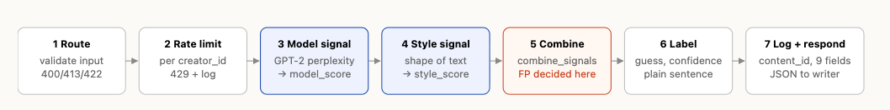

# Milestone 1 — Design before code

Four decisions made before building: the path a submission takes, what the two
signals measure (and miss), the false-positive trace that sets the thresholds,
and the contract for `/submit` and `/appeal`.

Numbers come from the starter code as it stands: `gpt2`, a 400-token cap,
logistic midpoint at perplexity 45 with steepness 1.6, weights 0.5 / 0.5,
thresholds 0.35 / 0.65. Where this doc proposes changing one, it says so.

---

## 1. The path a submission takes



| # | Passes through | What it adds |
|---|---|---|
| 1 | **Flask route `POST /submit`** (`app.py`) | Parses the JSON body. Rejects bad input before any model runs: missing, empty, non-string, too short or too long `text`, or a missing `creator_id`. Each rejection gets a clear error code, never a 500. |
| 2 | **Rate limiter** (Flask-Limiter, unit 8) | Counts requests per `creator_id`, falling back to IP address. Past the limit it returns 429 and writes a `rejected` entry to the log. |
| 3 | **Signal one: `detector.model_signal`** | Runs GPT-2 locally on the first 400 tokens and turns perplexity into a 0–1 `model_score` (higher = more AI-like). |
| 4 | **Signal two: `stylometry.style_signal`** | Measures the text's shape: sentence-length spread, punctuation use and stock AI words, combined into a 0–1 `style_score` (higher = more AI-like). |
| 5 | **Combining rule: `scoring.combine_signals`** | Merges the two scores into one `combined_score`. This is where the false-positive decision is made. |
| 6 | **Label mapping: `scoring.score_to_label`** | Turns the score into a `guess` (`ai` / `unsure` / `human`), a `confidence`, and a plain-language sentence a writer can understand. |
| 7 | **Audit log: `audit.log_decision`** then the JSON response | Gives the decision a `content_id`, writes all nine fields to `logs/audit.jsonl`, and returns the label, both signal scores and the `content_id` the writer needs if they want to appeal. |

---

## 2. The two signals

### Signal one — model signal (`detector.py`, given)

**What it measures.** How predictable the text is to GPT-2 (its perplexity),
mapped through a logistic curve so that low perplexity gives a high AI score.
Perplexity 45 scores 0.5, 25 scores 0.72, and 80 scores 0.29.

**Why it might differ.** A language model writes by repeatedly choosing a likely
next word, so its output is text that a language model finds easy to predict.
People wander: an odd word choice, a sudden turn, a specific detail no model
would guess.

**What it can't see.**
- **Who wrote it, only how ordinary the words are.** Plain writing in common
  words and short sentences scores as machine-like whoever wrote it: someone
  writing in a second language, a younger writer, anyone writing plainly on
  purpose. Dense, ornate prose goes the other way and reads as human. The
  writers it is most likely to accuse are the ones with the least room to
  argue back.
- **Anything after token 400** (roughly 300 words). A human opening paragraph
  followed by pages of AI text gets scored on the opening alone.
- **Small surface changes.** A few rare words, typos or odd synonyms raise
  perplexity and pull AI text toward "human". Paraphrasing tools exploit this.
- **Topic and length.** Perplexity shifts with subject matter. Technical,
  formulaic or list-like human writing (recipes, instructions, legal text)
  is predictable by nature.
- **Newer models.** GPT-2 is a 2019 model, and text from current models is not
  guaranteed to look predictable to it.

### Signal two — style signal (`stylometry.py`, mine)

**What it measures.** The shape of the text, without reading a word of it:
- *Sentence-length spread*: standard deviation of sentence length divided by
  the mean. Low spread is more AI-like.
- *Punctuation density*: semicolons, dashes, parentheses, colons, question and
  exclamation marks per 100 words. Uniform, sparse punctuation is more AI-like.

Vocabulary variety is deliberately not measured: people can have a set word
choice just as AI can, so it isn't a fair differentiator.

Each measure is scaled to 0–1 and flipped so that higher means more AI-like
before they are averaged.

**Why it might differ.** AI text tends to be even: mid-length sentence after
mid-length sentence, safe vocabulary, commas and full stops. Human writing is
lumpy. A three-word sentence sits next to a forty-word one, and people
use idiosyncratic punctuation.

**What it can't see.**
- **Meaning.** Anything that changes the shape without changing the content
  moves the score: added typos, sentences chopped or merged, a pasted
  quotation, a bulleted list.
- **Text the splitter misreads.** The sentence splitter only knows `.`, `!` and
  `?`. Unpunctuated text, poetry and lists become one giant "sentence"; and
  abbreviations like "e.g." create fake short ones.
- **Disciplined human style.** Writers trained toward even sentences and plain
  punctuation (journalists, technical writers, students taught a five-paragraph
  template) look AI-like. This overlaps with signal one's blind spot, so the two
  signals can share a mistake instead of cancelling it.

**The two blind spots overlap on plain writing.** When both signals fail, they
fail on the same people. The combining rule cannot assume that agreement
between the signals means the answer is right.

---

## 3. Tracing the false positive

**Who.** Mina is writing in her second language. She submits a 180-word
personal essay she wrote herself. She uses words she's sure of, sentences of
12–16 words, and full stops and commas only.

| Stage | What happens to Mina |
|---|---|
| Route | Valid input, accepted. |
| Signal one | Common words in a common order give perplexity ≈ 25, so **`model_score` ≈ 0.72**. |
| Signal two | Even sentence lengths and no unusual punctuation give **`style_score` ≈ 0.65**. |
| Combine (0.5 / 0.5) | **`combined_score` ≈ 0.685**. |
| Label (AI ≥ 0.65) | **`guess: "ai"`**. Both signals agreed, and they agreed because they share one blind spot. |
| Log | `status: "decided"`, with both scores stored. |

**What the label says to her.** Under the current placeholder, it's a flat
verdict. The wording needs to change. Even the AI label must:
1. say it is an estimate from patterns in the writing, not proof of anything;
2. never say "you used AI" (it guesses about the text, not about her);
3. tell her she can appeal and show the `content_id` she needs to do it.

**What she can do.**
- **Appeal.** `POST /appeal` with her `content_id` and her reasoning. The
  status moves to `under_review`, the appeal is logged beside the original
  decision, and the original decision is never overwritten. Nothing re-scores
  automatically; a person reviews it.
- **Resubmit.** Resubmitting would most likely get the same score (it's the
  same text) and use up her rate limit. Rewriting to "sound less like AI" is
  the wrong outcome: the system would be teaching real writers to write
  differently.

**Where she can get stuck.**
- She loses the `content_id`, so the response and label must show it.
- The appeal goes nowhere if no one reads `under_review` entries. That is out
  of scope for the code, but it has to be written down as a real gap.

**What this decides for thresholds (Milestone 4 and 5).** Mina's case sits
just above 0.65. So:
- **Move `AI_THRESHOLD` up to 0.75.** That puts her in "unsure" instead of "ai".
  The cost: more lightly edited AI text also lands in "unsure". On a writing
  site, that is the cheaper mistake.
- **Give the AI label a veto rule.** Only label `ai` if `model_score` **and**
  `style_score` are each ≥ 0.6, so one signal alone can never accuse.
- **Add a criterion.** Plain human calibration texts, written in short and
  common words, must not be labelled `ai`. This becomes one of the five in
  `criteria.md`.

---

## 4. Endpoint contracts

The same conventions apply to both endpoints:
- JSON in, JSON out, `Content-Type: application/json`.
- Scores are floats in [0, 1] rounded to 4 places, and higher always means
  more AI-like.
- Every error has the same shape: `{"error": "<code>", "message": "<sentence a person can read>"}`.
- No error is ever a 500 for bad input.

### `POST /submit`

**Request**

| Field | Type | Required | Rules |
|---|---|---|---|
| `text` | string | yes | Trimmed. 40 to 20,000 characters after trimming. Only the first 400 tokens (about 300 words) are scored by signal one. |
| `creator_id` | string | yes | Trimmed, 1–64 characters. Used for rate limiting and stored in the log. Not verified; this service has no login. |

Other fields are ignored.

**Response 200**

| Field | Type | Meaning |
|---|---|---|
| `content_id` | string (UUID4) | ID of this decision. Needed for `/appeal`. |
| `creator_id` | string | Echoed back, trimmed. |
| `guess` | `"ai"` \| `"unsure"` \| `"human"` | Machine-readable verdict. |
| `confidence` | float 0–1 | How far the combined score is from a coin flip: `abs(combined_score − 0.5) × 2`. Same formula for every guess: 0 means no lean either way, 1 means fully one-sided. |
| `label` | string | The full sentence shown to the writer. It includes how to appeal. |
| `model_score` | float 0–1 | Signal one. |
| `style_score` | float 0–1 | Signal two. |
| `combined_score` | float 0–1 | Output of `combine_signals`. |
| `truncated` | bool | `true` if the text was longer than signal one could read (400 tokens). |
| `status` | `"decided"` | Always `decided` on a new submission. |

```json
{
  "content_id": "3f6c1a7e-8b2d-4c51-9e0a-2d7f4b1c9a55",
  "creator_id": "mina_k",
  "guess": "unsure",
  "confidence": 0.37,
  "label": "We can't tell whether this was written by a person or with AI help…",
  "model_score": 0.72,
  "style_score": 0.65,
  "combined_score": 0.685,
  "truncated": false,
  "status": "decided"
}
```

**Errors**

| HTTP | `error` | When |
|---|---|---|
| 400 | `invalid_json` | Body missing, not valid JSON, or JSON that isn't an object. |
| 400 | `missing_text` | No `text` field. |
| 400 | `invalid_text` | `text` is not a string. |
| 400 | `empty_text` | `text` is empty or whitespace only. |
| 422 | `text_too_short` | Under 40 characters, or under 3 tokens (too short to score). |
| 413 | `text_too_long` | Over 20,000 characters. |
| 422 | `unsupported_input` | Not English prose (e.g. mostly non-Latin script, code, emoji only). The alternative is to score it but cap the result at `unsure`. Criterion 4 allows either, never `ai`. |
| 400 | `missing_creator_id` | `creator_id` missing, not a string, or empty after trimming. |
| 429 | `rate_limited` | Over the per-minute or per-day limit (unit 8). Logged as `rejected`. |
| 503 | `detector_unavailable` | GPT-2 could not be loaded. Nothing is logged as a decision. |

Rejected inputs (400 / 413 / 422) are written to the log with
`audit.log_rejection` so attacks leave a trace.

### `POST /appeal`

**Request**

| Field | Type | Required | Rules |
|---|---|---|---|
| `content_id` | string | yes | Must match a `decided` entry in the audit log. |
| `reasoning` | string | yes | Trimmed, 1–2,000 characters. The writer's explanation in their own words. |

The `creator_id` for the appeal comes from the original decision, not from the
caller.

**Response 200**

| Field | Type | Meaning |
|---|---|---|
| `content_id` | string | Echoed back. |
| `status` | `"under_review"` | The new status. |
| `previous_status` | `"decided"` | What it was before. |
| `original_guess` | string | The guess being appealed. Nothing is changed or deleted. |
| `appealed_at` | string (ISO 8601 UTC) | Timestamp of the appeal entry. |
| `message` | string | For the writer: "Your appeal is recorded. A person will review it. Your original result is marked as under review." |

**Errors**

| HTTP | `error` | When |
|---|---|---|
| 400 | `invalid_json` | Same as `/submit`. |
| 400 | `missing_content_id` | Missing, not a string, or empty. |
| 404 | `unknown_content_id` | No decision with this ID exists in the log. |
| 400 | `missing_reasoning` | Missing, not a string, or empty after trimming. |
| 413 | `reasoning_too_long` | Over 2,000 characters. |
| 409 | `already_under_review` | This `content_id` already has an open appeal. |

**Side effect.** One `audit.log_appeal` entry is appended. The log is
append-only, so the original decision stays where it was.

### Read-back: could someone build against this without asking me?

These are the questions a builder would ask, each answered above:
- *Which way do the scores point?* Higher always means more AI-like.
- *What does `confidence` mean for "unsure"?* It uses the same formula as
  the other guesses.
- *Is `creator_id` trusted?* No. It is only used for rate limiting and the log.
- *What happens with text over 400 tokens?* It is accepted, only the start is
  scored, and `truncated: true` is returned.
- *Can the writer appeal twice?* No, a second appeal gets a 409.
- *Can anyone appeal someone else's item?* Yes. There is no login, so anyone
  holding the `content_id` can appeal it. This is a known limit, accepted for
  this project.

Still open for later milestones: the final combining rule and thresholds
(Milestones 4 and 5) and the per-minute and per-day numbers (unit 8). The
contract does not change when those numbers do.
